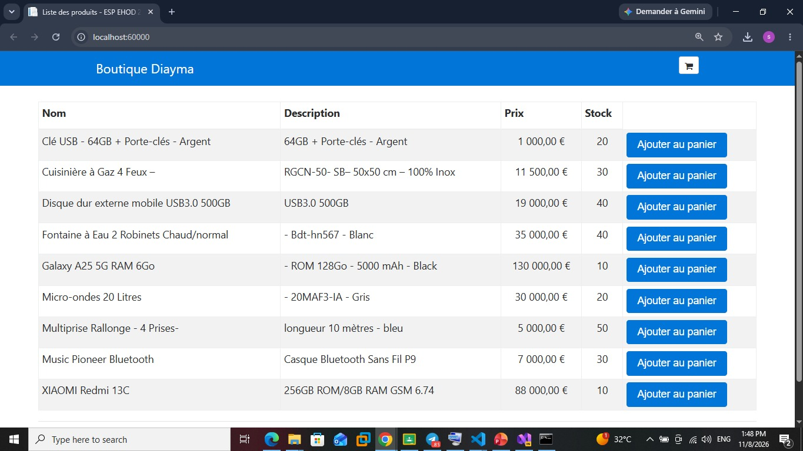
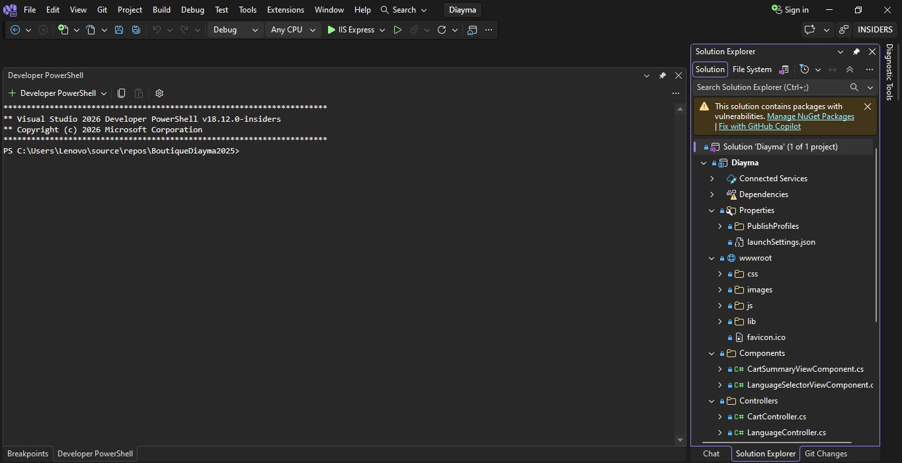
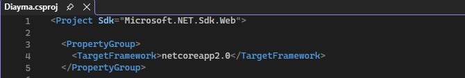
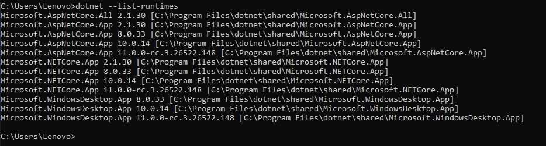
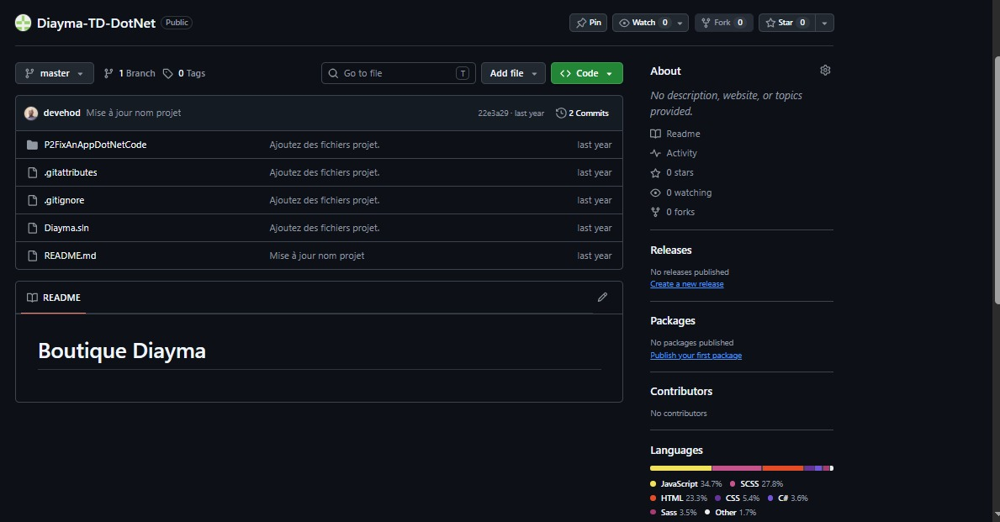
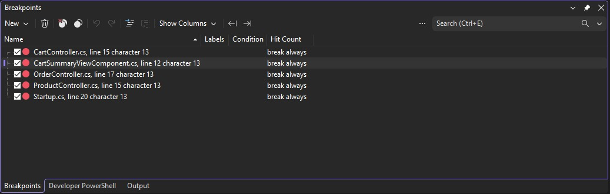
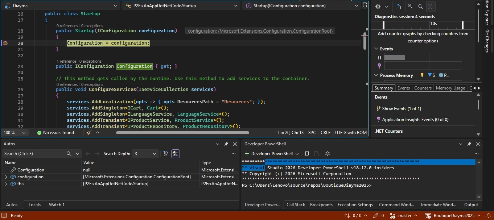
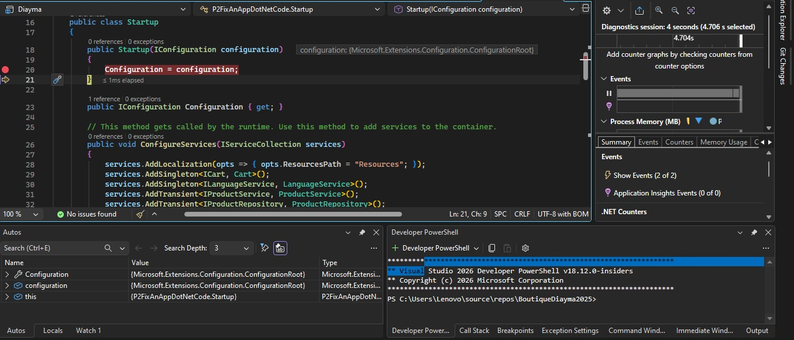
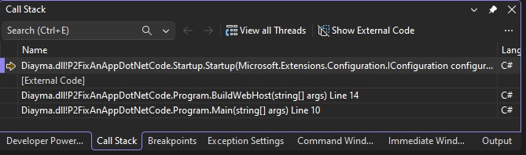
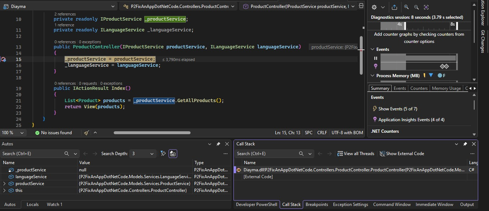

# TD .NET : Boutique Diayma

**Université Cheikh Anta Diop, École Supérieure Polytechnique, Département Génie Informatique**
**Enseignement .NET, TD du 03 novembre 2026**
**Étudiant(e)** : VOTRE NOM

Dépôt personnel : **Diayma-TD-DotNet** (public), branche `master`.

## 1. Environnement
- IDE : Visual Studio 2026 Insiders
- Application web ASP.NET Core MVC
- Exécution locale : `http://localhost:60000`

## 2. Tâche 1 : récupération et exécution du code
Le code a été cloné dans Visual Studio puis exécuté avec **F5**. Le premier lancement a échoué :

> The program '[9764] dotnet.exe' has exited with code 2147516566 (0x80008096).

Cause : le runtime .NET demandé par le projet n'était pas installé (voir tâche 4). Après installation, l'application affiche la liste des produits.



## 3. Tâche 2 : projets de la solution
La solution `Diayma` contient **1 projet** : `Diayma` (« 1 of 1 project »).



## 4. Tâche 3 : version .NET utilisée
Le fichier `Diayma.csproj` indique `<TargetFramework>netcoreapp2.0</TargetFramework>` : le projet cible **.NET Core 2.0**.



## 5. Tâche 4 : installation du composant .NET
Le lien **Install** de Visual Studio a ouvert le Visual Studio Installer, où le composant **.NET Core 2.1 Runtime** a été coché et installé. La commande `dotnet --list-runtimes` confirme `Microsoft.NETCore.App 2.1.30` et `Microsoft.AspNetCore.App 2.1.30`. Un projet .NET Core 2.0 s'exécute sur ce runtime 2.1.



## 6. Tâche 5 : dépôt GitHub personnel
Le dépôt d'origine a été renommé `upstream`, puis un nouveau dépôt public a été lié comme `origin` :

```
git remote rename origin upstream
git remote add origin https://github.com/<mon-compte>/Diayma-TD-DotNet.git
git push -u origin master
```



## 7. Tâche 6 : bugs trouvés

**Bug 1 : le stock ne diminue pas après une commande.**
- Action : valider une commande.
- Attendu : le stock du produit commandé diminue de la quantité achetée.
- Observé : le stock affiché reste inchangé.

**Bug 2 : le Total du panier est faux.**
- Action : ajouter 3 fois « Clé USB - 64GB + Porte-clés - Argent » (1 000 €) au panier.
- Attendu : Total = 3 000 €, y compris dans l'en-tête.
- Observé : le sous-total affiche 3 000 €, mais le Total affiche 1 000 €, et l'en-tête aussi (« 3 item(s) 1 000,00 € »).

## 8. Tâche 7 : points d'arrêt posés

| Fichier | Ligne | Instruction |
|---|---|---|
| `CartSummaryViewComponent.cs` | 12 | `_cart = cart as Cart;` |
| `ProductController.cs` | 15 | `_productService = productService;` |
| `OrderController.cs` | 17 | voir capture |
| `CartController.cs` | 15 | voir capture |
| `Startup.cs` | 20 | `Configuration = configuration;` |



## 9. Tâche 8 : parcours avant l'affichage des produits

### Parcours chronologique

| N° | Namespace | Classe | Méthode | Mode | Observation |
|---|---|---|---|---|---|
| 1 | `P2FixAnAppDotNetCode` | `Program` | `Main` (l. 10) | pile d'appels | Point d'entrée de l'application. |
| 2 | `P2FixAnAppDotNetCode` | `Program` | `BuildWebHost` (l. 14) | pile d'appels | Construit l'hôte web et crée `Startup`. |
| 3 | `P2FixAnAppDotNetCode` | `Startup` | `Startup(IConfiguration)` | F10 | `Configuration` vaut `null`, puis `ConfigurationRoot` après la ligne 20. |
| 4 | `P2FixAnAppDotNetCode.Controllers` | `ProductController` | constructeur (l. 15) | F10 | Injection de `ProductService`. |
| 5 | `P2FixAnAppDotNetCode.Controllers` | `ProductController` | `Index()` | F10 | Appelle `GetAllProducts()` (l. 21). |
| 6 | `P2FixAnAppDotNetCode.Models.Services` | `ProductService` | `GetAllProducts()` (l. 25) | F11 | Appelle le repository (l. 29). |
| 7 | `P2FixAnAppDotNetCode.Models.Repositories` | `ProductRepository` | `GetAllProducts()` (l. 42) | F11 | Filtre `Stock > 0`, trie par nom, retourne un tableau. |
| 8 | `P2FixAnAppDotNetCode.Components` | `CartSummaryViewComponent` | constructeur (l. 12) | F5 | Appelé depuis `_Layout.cshtml` : crée l'en-tête du panier. |

Ensuite, la page des produits s'affiche dans le navigateur.

### Choix des modes de pas à pas
- **Pas à pas principal (F10)** : sur les lignes simples, pour observer leur effet sans entrer plus loin.
- **Pas à pas détaillé (F11)** : sur `GetAllProducts()`, code du projet à explorer ; deux F11 successifs mènent de `ProductService` à `ProductRepository`.
- **Pas à pas sortant (Maj+F11)** : approprié pour quitter `ProductRepository` une fois son filtrage compris, afin de revenir directement dans `Index()`.
- **Continuer (F5)** : entre les points d'arrêt, pour éviter le code du framework (`[External Code]`).

### Points d'arrêt non atteints
`OrderController` (l. 17) et `CartController` (l. 15) ne sont pas atteints avant l'affichage des produits : ils ne servent qu'au panier et à la commande.

### Captures
**Startup, avant F10** : `Configuration` vaut `null`.


**Startup, après F10** : `Configuration` vaut `ConfigurationRoot`.


**Pile d'appels de Startup** : `Main`, `BuildWebHost`, `Startup`.


**ProductController, constructeur.**


**ProductService.GetAllProducts() (F11).**


**ProductRepository.GetAllProducts() (F11).**


**CartSummaryViewComponent, constructeur.**
